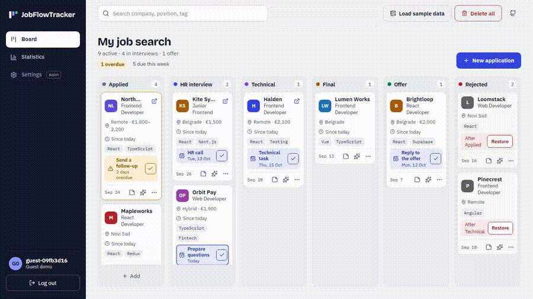
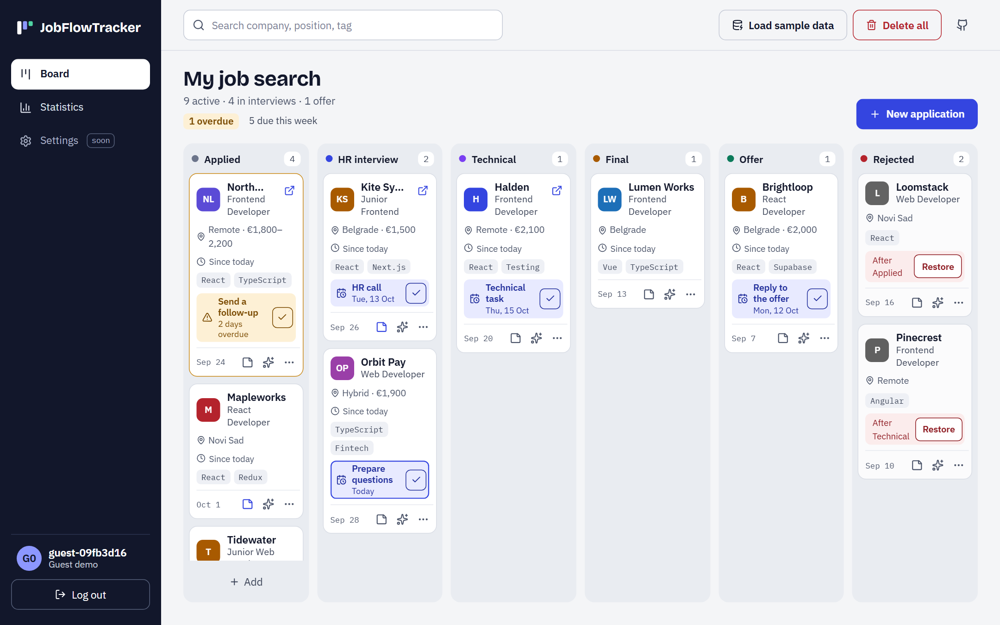
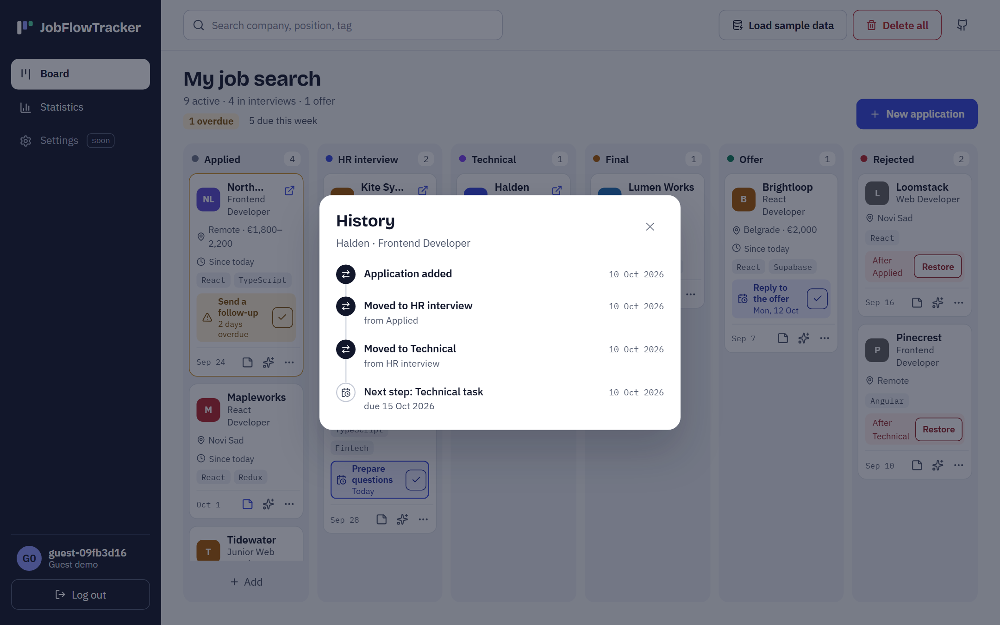
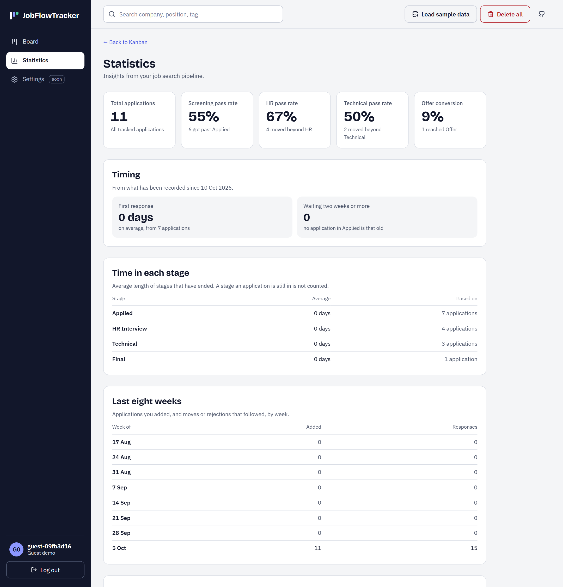
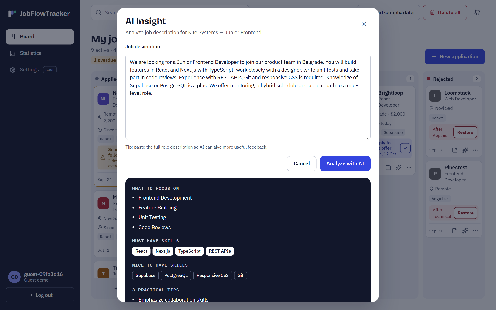
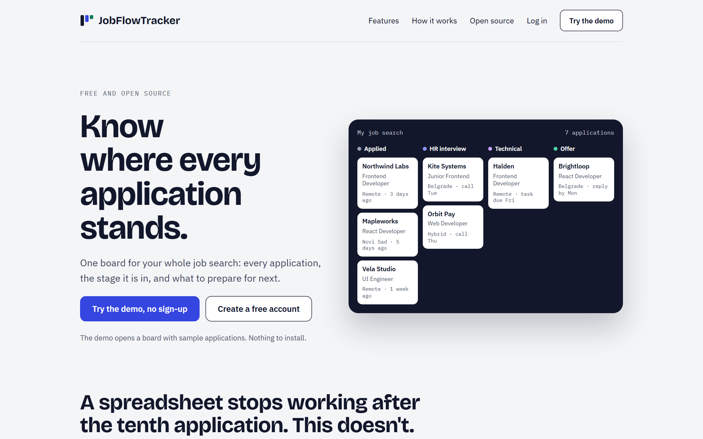
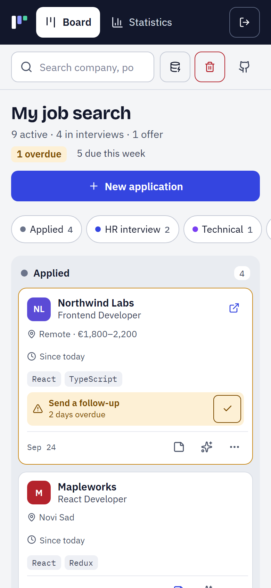
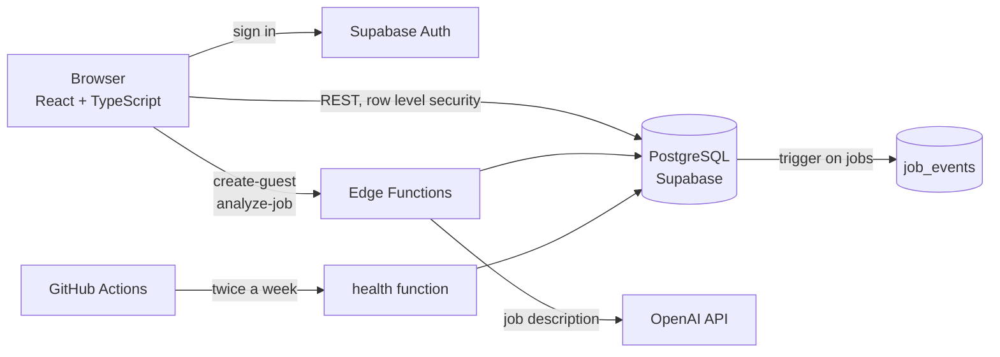

# JobFlowTracker

[](https://github.com/luidji95/Job-Application-Tracker/actions/workflows/ci.yml)

One board for a whole job search: every application, the stage it is in, what to do next and how long it has been waiting.

**Live:** [jobflowtracker.com](https://jobflowtracker.com) — click **Try the demo** to get a board with sample applications, no sign-up.



## What it does

| | |
|---|---|
| **Board with six stages** | Applied, HR interview, Technical, Final, Offer, Rejected. Drag a card or move it from its menu. A rejected application remembers the stage it came from and can be restored. |
| **Next step with a due date** | Each application can carry one next step. Steps due today are outlined, late ones turn amber, and a check mark clears a finished step. |
| **History** | Every move, rejection and step is recorded with its date. The card shows how long an application has been in its stage. |
| **Statistics from the history** | Pass rates per stage, average time to the first response, average length of each stage, applications waiting two weeks or more, and activity by week. |
| **AI brief for a job ad** | Paste a job description and get what to focus on, must-have and nice-to-have skills, and three practical tips. The result can be saved into the notes. |
| **Search** | Across company, position, location and tags; choosing a result scrolls to the card and highlights it. |
| **Guest demo** | A temporary account with sample data, removed after 24 hours. |

## Screenshots

**Board**



**History of one application**



**Statistics**



**AI brief**



<table>
  <tr>
    <td width="68%"><strong>Landing page</strong><br><br></td>
    <td><strong>Phone</strong><br><br></td>
  </tr>
</table>

## How it is built



| Layer | Technology |
|---|---|
| Interface | React 19, TypeScript, Vite, React Router, React Hook Form, Zod, dnd-kit |
| Data and sign-in | Supabase: PostgreSQL with row level security, Auth |
| Server logic | Supabase Edge Functions (Deno) |
| Tests and CI | Vitest, ESLint, GitHub Actions |
| Hosting | Vercel |

A few decisions worth knowing about:

- **Rules live in the database.** Allowed stages and statuses, required fields and the link format are `CHECK` and `NOT NULL` constraints. The interface validates too, but a request that skips the interface is still refused.
- **History is written by a trigger.** `job_events` is filled by a trigger on `jobs`, so no code path in the app can forget to record a move, and a client cannot insert or change history.
- **Stage logic is pure functions.** What changes when a card moves, how statistics are counted and how dates are compared are plain functions without React or network calls. The board, the drag and drop and the tests all use the same ones.
- **Moves show immediately.** A dropped card changes column at once and goes back if the server refuses.

## Security

- **Row level security on every table.** A user reads and changes only their own applications and profile, and reads only their own history.
- **Edge functions check who is calling.** The AI function accepts only a signed-in user; the public app key alone is refused.
- **Usage limits.** 10 AI analyses per user per day (3 for a guest), 300 per day in total, input cut at 6,000 characters. At most 5 guest sessions per address per hour.
- **Guest accounts are temporary.** They are deleted with their data after 24 hours.
- **Errors do not leak details.** Functions answer with a short message and log the cause on the server.
- **Deleting a user deletes their data.** Profile, applications and history go with the account through cascading foreign keys.

## Tests

```bash
npm test
```

113 unit tests cover the logic that is easy to get wrong:

- every possible move between stages, checked against the same rules the database enforces
- statistics: funnel, pass rates, time in stage, first response, weekly activity
- history: the timeline, stage durations, applications older than the history
- due dates: today, tomorrow, overdue, month ends, clock changes
- search, input clean-up and error messages from the edge functions

CI runs the linter, the tests and a production build on every push to `main` and on every pull request.

What is not covered: components and full browser flows have no automated tests, and calls to the database are not tested automatically.

## Running it locally

You need Node 22 and a Supabase project.

```bash
git clone https://github.com/luidji95/Job-Application-Tracker.git
cd Job-Application-Tracker
npm install
```

Create `.env` in the project root:

```
VITE_SUPABASE_URL=https://<your-project>.supabase.co
VITE_SUPABASE_ANON_KEY=<your anon key>
```

Create the database and deploy the functions with the [Supabase CLI](https://supabase.com/docs/guides/cli):

```bash
npx supabase link --project-ref <your-project>
npx supabase db push
npx supabase functions deploy create-guest
npx supabase functions deploy analyze-job
npx supabase functions deploy health --no-verify-jwt
npx supabase secrets set OPENAI_API_KEY=<your key>
```

Then:

```bash
npm run dev
```

| Command | What it does |
|---|---|
| `npm run dev` | start the development server |
| `npm test` | run the unit tests once |
| `npm run test:watch` | run the tests on every change |
| `npm run lint` | run ESLint |
| `npm run build` | type-check and build for production |

## Project structure

```
src/
  pages/               landing, sign-in, dashboard, statistics
  features/components/ board, columns, cards, modals, jobs context
  lib/jobs/            stage transitions, statistics, history, due dates, search (with tests)
  lib/auth/            guest demo and guest detection
  schemas/             Zod schemas for the forms
supabase/
  migrations/          the whole database: tables, constraints, policies, triggers
  functions/           create-guest, analyze-job, health
.github/workflows/     CI and the keep-awake check
```

## Known limits

- The order of cards inside a column is not saved; cards are listed newest first.
- History starts in October 2026. Older applications show when they were added and where they were at that point, not the moves in between.
- The interface is in English only.
- The database is on Supabase's free plan, which pauses inactive projects. A scheduled check twice a week keeps it awake.

---

Built by [Miloš Petrović](https://github.com/luidji95).
